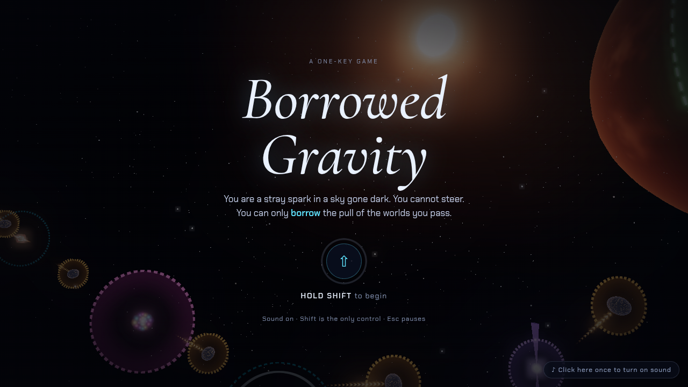
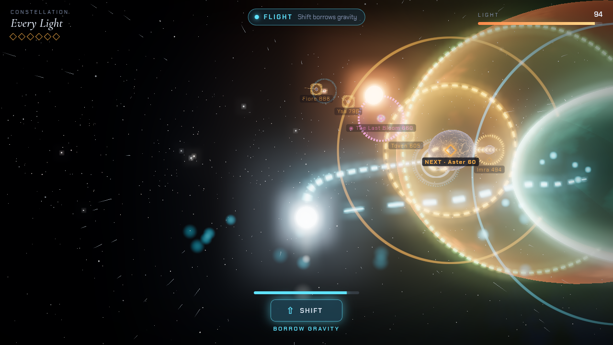
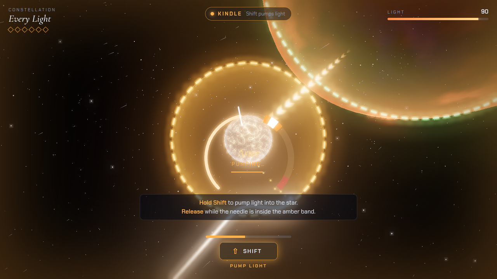
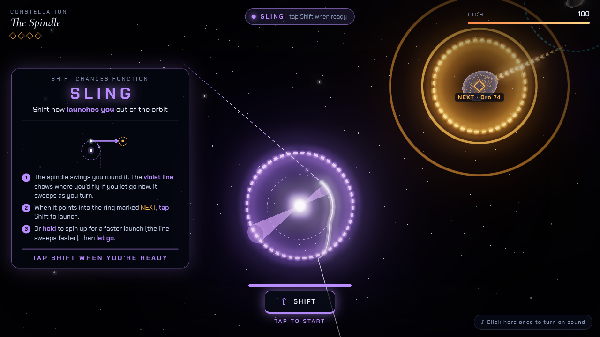
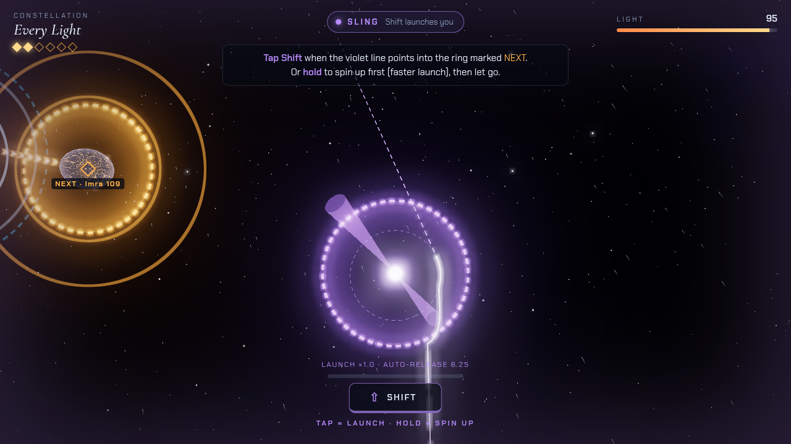
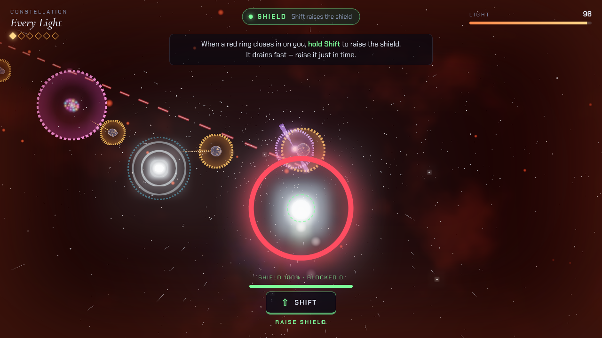
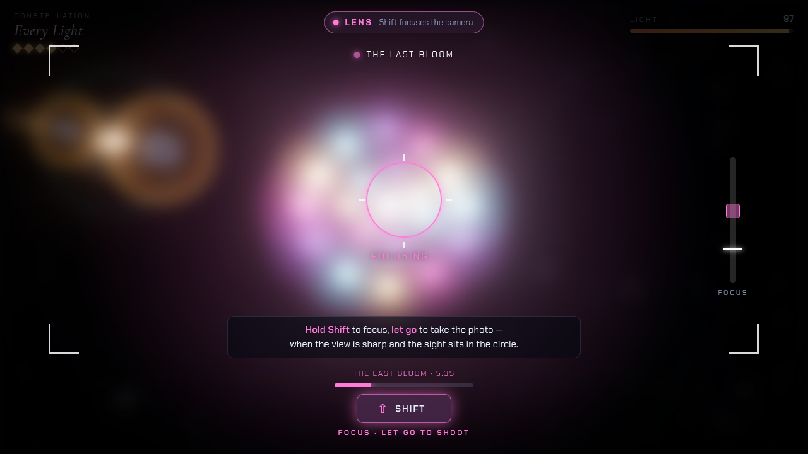
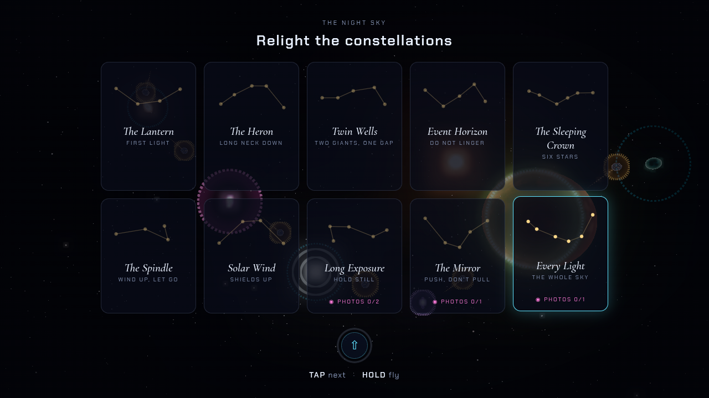
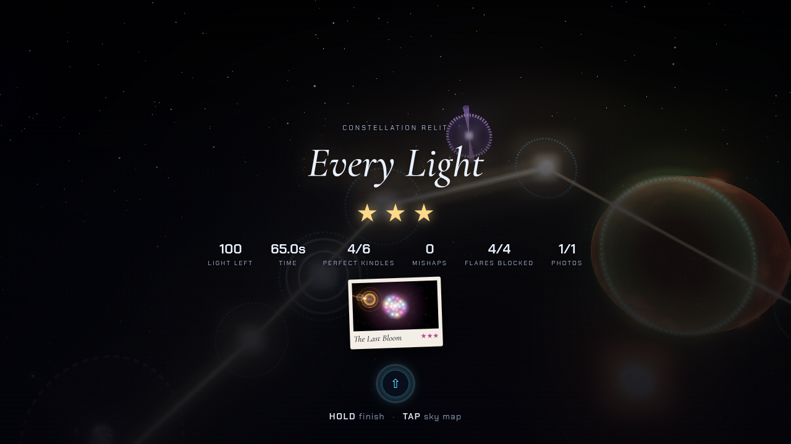

# Borrowed Gravity

A 3D space game you play with **one key: Shift**.

You are a spark drifting through a dark sky, and you can't steer. Hold **Shift** near a
planet to borrow its gravity, and let go to be pulled. A live path shows where you'll go
if you let go *now*. On the way, Shift changes job:
- it pumps light into cold stars
- it spins you up in a sling
- it raises a shield against flares
- it focuses a camera for photos

Every switch is announced with a how-to card, and the game waits for you: time holds
until you tap Shift to start the next job, so two jobs never overlap and you're never
rushed.



| | |
|---|---|
|  **Flight**: hold to borrow gravity. The path shows where you'd go if you let go now. **NEXT** marks where to go. |  **Kindle**: hold to pump light, release in the amber band. |
|  **Every switch waits for you**: a card explains what Shift does next, and time holds until you tap. |  **Sling**: the spindle swings you round. Tap when the violet line points at NEXT. |
|  **Shield**: raise it when the red ring meets the spark. |  **Lens**: hold to focus, let go to take the photo. Each shot is scored for sharpness and framing. |
|  **Ten constellations** to relight, each with medals and a photo album. |  Relight every star and **the constellation draws itself** across the sky. |

See **[GAME_DESIGN.md](GAME_DESIGN.md)** for the full design: mechanics, mode-switch
rules, goals and levels.

## Play

```bash
npm install
npm run build          # → dist/borrowed-gravity.html  (one file, double-click to play)
```

Or run it in Docker, which serves the game at <http://localhost:8000>:

```bash
docker build -t borrowed-gravity .
docker run --rm -p 8000:8000 borrowed-gravity
```

Or use the dev server while developing:

```bash
npm run dev            # http://localhost:8000  (rebuilds on reload)
```

## Controls

| Mode (colour) | Shift does |
|---|---|
| **Flight** (cyan) | hold = borrow gravity from the body whose dashed ring you're in · release = get pulled (white holes push) |
| **Kindle** (amber) | hold = pump light into the star · release inside the amber band = ignite |
| **Sling** (violet) | tap = launch along the violet line now · hold = spin up first (faster launch, faster sweep), let go = launch |
| **Shield** (green) | hold = shield up (it drains) · raise it when a red warning ring reaches the spark |
| **Lens** (pink) | hold = focus · release = take the photo when it's sharp and framed |
| **Ready** (card in the next mode's colour) | tap = start the next mode. Time holds until you do: no light drain, no clock |
| Menus | tap = next · hold = choose |

**A ring's colour tells you what Shift will become** when you fly into it.

- **Esc / P** pauses. These are system keys, not game controls.
- On touch screens, a press anywhere acts as Shift.
- **Sound:** browsers only allow audio after a click, and Shift alone doesn't count.
  Click the small ♪ pill once (bottom right).
- On Windows, pressing Shift 5 times opens the *Sticky Keys* prompt. Turn that shortcut
  off under *Settings → Accessibility → Keyboard*.

## Reading the screen

- **NEXT marker**: the next stop on the route, a cold star or a spindle to swing through.
  Off screen it turns into an arrow at the edge. In the sky, rings ping out from it.
- **Bright dashed path**: where you go if you let go now. Its end colour says what you'll
  hit: red = impact, amber = cold star, violet = spindle, green = storm, pink = photo.
- **Faint path**: where you go if you keep holding until the charge is full.
- **Dashed cyan ring**: a body's gravity field. You can only borrow inside it.
- **Amber chevron beam on a cold star**: the direction the star throws you after kindling.
- **Light bar**: drains as you fly. Kindling and photos refill it. Crashes, flare hits
  and getting lost cost light.
